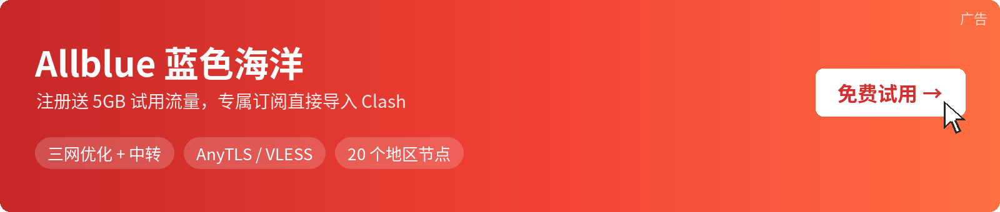

### 🚀最后更新时间: 2026-11-26 00:15:42

# Allblue 免费 Clash 订阅（Clash Verge Rev / FlClash / Clash Meta）

本仓库自动更新 Allblue 的公益免费 Clash 订阅，Clash Verge Rev、FlClash、Clash Meta for Android 这类 mihomo 内核客户端复制链接就能导入。

- 公益流量用完后，脚本会自动换上新的订阅链接，最后更新时间见第一行。
- 节点全部超时，回本页复制新链接，在客户端里重新更新订阅。

[](https://y6ptq1.allblueaff.com/tlyPMmHu)

| Allblue 蓝色海洋 | 注册送 5GB 试用流量 · 三网优化 + 中转 · AnyTLS / VLESS · Clash 客户端直接导入 | [点击注册 Allblue →](https://y6ptq1.allblueaff.com/tlyPMmHu) |
|---|---|---|

## 免费 Clash 订阅链接

### 🚀免费Clash订阅链接（Clash Verge Rev / FlClash / Clash Meta for Android 通用）

```
https://Var4HR.absslk.xyz/0f44aec832679568f0135fcc0a876f12
```

## 选哪个 Clash 客户端

| 设备 | 推荐客户端 | 官方下载 | 中文教程 |
|---|---|---|---|
| Windows / macOS / Linux | Clash Verge Rev | [GitHub Releases](https://github.com/clash-verge-rev/clash-verge-rev/releases) | [Clash Verge Rev 教程](https://volya2026.github.io/proxy-client-guide/clash-verge-rev/) |
| 安卓 / 电脑都想用同一个 | FlClash | [GitHub Releases](https://github.com/chen08209/FlClash/releases) | [FlClash 教程](https://volya2026.github.io/proxy-client-guide/flclash/) |
| 安卓 | Clash Meta for Android | [GitHub Releases](https://github.com/MetaCubeX/ClashMetaForAndroid/releases) | [Clash Meta for Android 教程](https://volya2026.github.io/proxy-client-guide/clash-meta-for-android/) |
| macOS（另一种选择） | Clash Party | [GitHub Releases](https://github.com/mihomo-party-org/clash-party/releases) | [Clash Party 教程](https://volya2026.github.io/proxy-client-guide/clash-party/) |

这几个客户端都用 mihomo 内核，AnyTLS 和 VLESS 节点都能用。停更多年的老版 Clash 不支持这两种协议，导入后节点会报错。

## Clash Verge Rev 导入订阅（电脑）

1. 打开 Clash Verge Rev，点左侧「订阅」。
2. 把上面的链接粘贴到顶部「订阅文件链接」输入框，点「导入」。
3. 导入后订阅会变成一张卡片，点这张卡片启用它。
4. 点左侧「代理」，点「延迟测试」，选一个有延迟数字的节点；顶部模式保持「规则」。
5. 回到首页打开「系统代理」开关，浏览器就能用了。游戏、命令行不走代理时，再改开「虚拟网卡模式」（TUN）。

## FlClash 导入订阅（安卓 / 电脑）

1. 第一次打开先确认免责声明：点「同意」，按提示把声明原文输入一遍再点「确定」。
2. 进入「配置」页面，点「添加配置」（已有配置时是右上角的加号），选「链接」，粘贴订阅链接，点「提交」。
3. 配置卡片右侧出现蓝色勾就是选中了。进入「代理」页面，点闪电图标测延迟，再点一个延迟正常的节点。
4. 回到「仪表盘」点「启动」。安卓第一次会弹出连接请求，点「确定」；电脑上还要打开「系统代理」或「虚拟网卡」其中一个开关。

## Clash Meta for Android 导入订阅（安卓）

1. 首页点「配置」，再点右上角加号，选「URL（从 URL 导入）」。
2. 「名称」随便填，「URL」粘贴订阅链接，「自动更新」可以填 1440（每天更新一次），点右上角保存图标，等「正在校验」消失。
3. 回到配置列表，点卡片左侧的圆圈选中它，再回首页点「点此启动」，第一次弹出网络连接请求点「确定」。
4. 首页点「代理」，切到「节点选择」这类策略组，点右下角闪电按钮测延迟，选一个延迟正常的节点。

## 免费订阅的实际限制

- **多人共用**：晚上人多时速度明显下降，延迟测试经常超时。
- **链接会换**：流量用完就换新链接，旧链接失效后要回本页重新复制。
- **只适合临时用**：查资料、看网页够用，长期办公、看视频、用 AI 工具建议用自己的账号。

想长期稳定用，可以注册自己的 Allblue 账号，拿到专属 Clash 订阅，导入方法和上面一样，注册就送 5GB 试用流量，先试再决定：

| Allblue 蓝色海洋 | 注册送 5GB 试用流量 · 三网优化 + 中转 · AnyTLS / VLESS · Clash 客户端直接导入 | [点击注册 Allblue →](https://y6ptq1.allblueaff.com/tlyPMmHu) |
|---|---|---|

## 常见问题

**Clash Verge Rev 导入时提示失败？**<br/>
先确认链接复制完整（从 `https://` 开头到最后一个字符），再看客户端是不是最新版本。仍然失败就回本页，看第一行的更新时间，复制最新链接重新导入，旧链接的流量用完也会导入失败。

**导入成功了，但节点全部超时？**<br/>
多半是这个链接的流量已经用完。回本页复制新链接，在客户端里更新订阅；Clash Meta for Android 和 FlClash 也可以在配置卡片上手动点更新。

**用老版 Clash 导入后节点报错？**<br/>
停更多年的老版 Clash 不支持 AnyTLS 等新协议，换成上面表格里的客户端就行，订阅链接不用改。

**多久更新一次？**<br/>
不按固定时间。脚本会自动检测，链接的流量用完就换上新的，所以一天可能更新好几次，以第一行的时间为准。

**能用来下载大文件吗？**<br/>
请不要。流量是大家共用的，下载大文件会很快把链接的流量用完，影响所有人。

## 延伸阅读

- [Allblue 机场评测](https://tuijianvpn.com/2878)：套餐、线路和使用体验的完整介绍。
